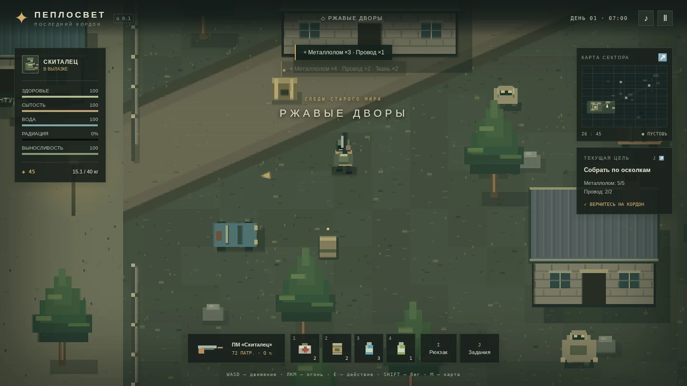
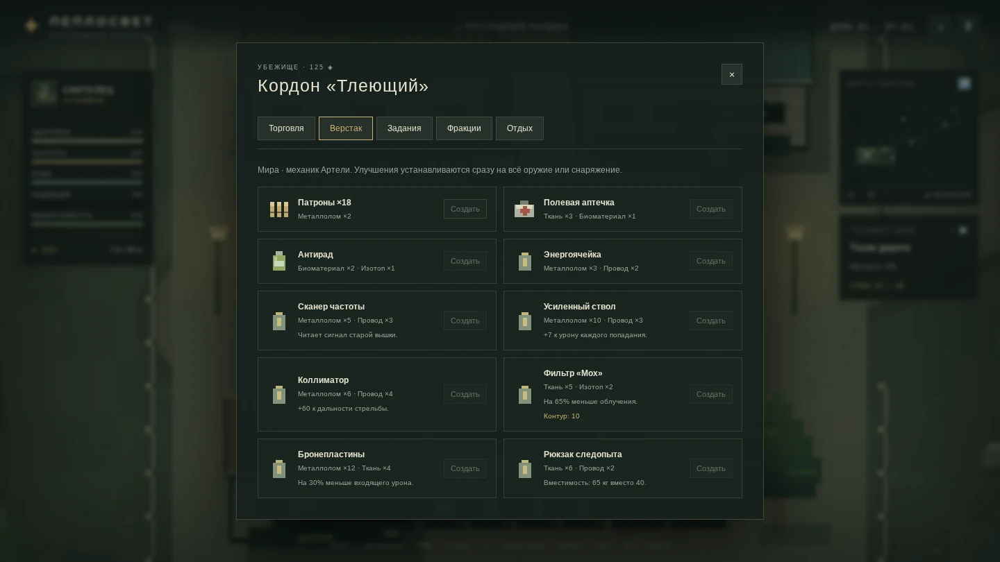

# Пеплосвет: Последний кордон / Ashglint: The Last Cordon

Пиксельная браузерная игра на выживание. Выходите из кордона за припасами, сражайтесь с мутантами и возвращайтесь в убежище, чтобы торговать и улучшать снаряжение.

- Альфа 0.1 с открытой картой, кампанией из шести глав и тремя фракциями.
- JavaScript и Canvas 2D, управление с клавиатуры и мыши или с сенсорного экрана.

## Запуск

Понадобится Node.js с npm. Установка зависимостей не требуется.

```bash
npm start
```

Откройте [локальную игру](http://127.0.0.1:4175). `npm test` проверяет игровую логику и интеграцию с имитацией Яндекс SDK.

`npm run package` создаёт архив для черновика в Яндекс Играх через PowerShell. Результаты проверок описаны в [QA.md](QA.md).

## Скриншоты



